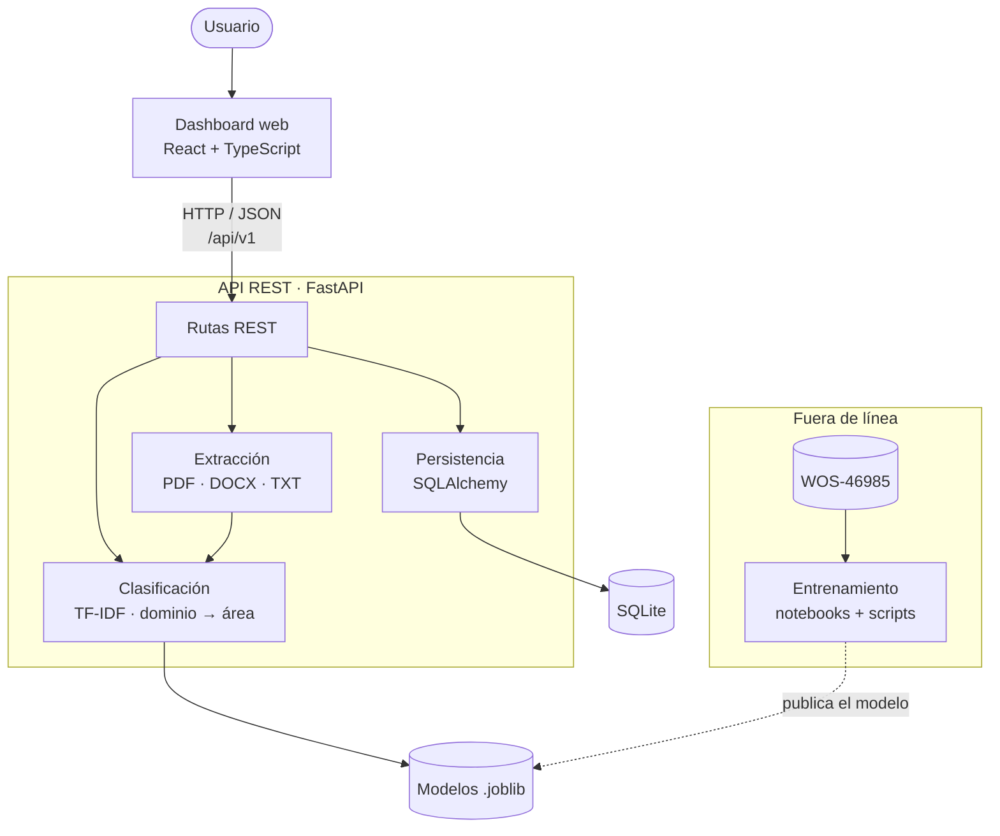

<div align="center">

# SICDA

### Sistema Inteligente de Clasificación de Documentos Académicos

**Aplicación web que clasifica documentos académicos por dominio y área temática usando Procesamiento de Lenguaje Natural y aprendizaje automático.**


Proyecto Integrador · Universidad de Pamplona · 2026

</div>

---

## Tabla de contenido

- [Descripción](#descripción)
- [Características](#características)
- [Arquitectura](#arquitectura)
- [Estructura del repositorio](#estructura-del-repositorio)
- [Stack tecnológico](#stack-tecnológico)
- [Inicio rápido](#inicio-rápido)
- [Dataset](#dataset)
- [Hoja de ruta](#hoja-de-ruta)
- [Cómo contribuir](#cómo-contribuir)
- [Equipo](#equipo)

## Descripción

Clasificar documentos académicos a mano es lento cuando el volumen crece. Este sistema recibe un documento (PDF, DOCX o TXT), extrae su resumen y predice en dos niveles:

1. **Dominio académico** (7 clases), por ejemplo *Computer Science* o *Medical*.
2. **Área temática** dentro de ese dominio (136 áreas en total, ver [ADR 0002](docs/decisiones/0002-etiquetas-wos.md)), por ejemplo *Computer vision*.

Los modelos se entrenan con el dataset **Web of Science WOS-46985** (Kowsari et al., 2017), que contiene 46.985 resúmenes en inglés etiquetados jerárquicamente.

## Características

- Carga de documentos PDF, DOCX y TXT, o texto pegado directamente.
- Detección automática del resumen (*Abstract*) y del idioma.
- Clasificación jerárquica dominio → área, con nivel de confianza.
- Las 3 alternativas más probables y los términos que más influyeron en la predicción.
- Aviso de **revisión humana** cuando la confianza es baja.
- Historial de clasificaciones y corrección por parte del usuario.
- Panel de métricas con la comparación de 3 modelos: Naive Bayes, SVM lineal y DistilBERT.
- API REST documentada automáticamente con OpenAPI/Swagger.

## Arquitectura



La API carga el modelo activo una sola vez al iniciar y **nunca entrena durante una consulta**. El preprocesamiento vive en el paquete compartido `clasificador_ml`, que usan tanto el entrenamiento como la API, para que el texto se procese igual en ambos lados.

## Estructura del repositorio

```text
sicda/
├── backend/                 # API REST (FastAPI)
│   ├── app/
│   │   ├── api/v1/          # rutas y endpoints
│   │   ├── core/            # configuración
│   │   ├── schemas/         # contratos JSON (Pydantic)
│   │   ├── extraccion/      # texto de PDF/DOCX/TXT, resumen, idioma
│   │   ├── clasificacion/   # carga del modelo y predicción jerárquica
│   │   └── db/              # modelos y acceso a la base de datos
│   └── tests/
├── ml/                      # paquete clasificador_ml: datos, PLN, entrenamiento, evaluación
│   ├── src/clasificador_ml/
│   ├── configs/             # hiperparámetros por modelo (YAML)
│   └── tests/
├── frontend/                # dashboard web (React + TypeScript + Vite)
├── docker-compose.yml       # levanta API + dashboard
├── notebooks/               # análisis exploratorio y comparación de modelos
├── data/                    # dataset crudo y procesado (no se versiona)
├── models/                  # modelos entrenados .joblib (no se versionan)
├── tests/e2e/               # pruebas de extremo a extremo (Playwright)
├── docs/                    # documentación y registro de decisiones
└── scripts/                 # configuración del entorno y utilidades
```

Cada carpeta principal tiene su propio `README.md` con los detalles.

## Stack tecnológico

| Capa | Tecnología |
| --- | --- |
| Backend y ML | Python 3.12, FastAPI, Uvicorn, Pydantic |
| PLN y modelos | scikit-learn, spaCy, NLTK, Hugging Face Transformers, PyTorch |
| Extracción | PyMuPDF, python-docx, langdetect |
| Datos | SQLite + SQLAlchemy, pandas, Parquet |
| Frontend | React 19, TypeScript, Vite, Tailwind CSS, shadcn/ui, Recharts |
| Pruebas y calidad | pytest, httpx, ruff, Vitest, Testing Library, oxlint, Playwright |
| Entorno y despliegue | uv, Docker, Docker Compose, GitHub Actions |

## Inicio rápido

> El proyecto está en su fase inicial. Por ahora la API solo expone `GET /api/v1/salud` y el dashboard muestra la navegación entre vistas.

### Requisitos

| Herramienta | Versión | Instalación |
| --- | --- | --- |
| Git | cualquiera reciente | <https://git-scm.com> |
| uv | 0.8 o superior | Linux/macOS: `curl -LsSf https://astral.sh/uv/install.sh \| sh`<br>Windows: `powershell -ExecutionPolicy ByPass -c "irm https://astral.sh/uv/install.ps1 \| iex"` |
| Node.js | 22 LTS | <https://nodejs.org> |
| Docker *(opcional)* | 24 o superior | <https://docs.docker.com/get-docker/> |

No necesitas instalar Python a mano: `uv` descarga Python 3.12 solo para este proyecto, sin tocar el Python de tu sistema ni los entornos de otros proyectos.

### 1. Clonar y configurar el entorno

```bash
git clone https://github.com/ElkinAcevedo/sicda.git
cd sicda
```

Ejecuta el script de configuración de tu sistema operativo. Crea el entorno `.venv` con Python 3.12, instala las dependencias de Python y Node y descarga los recursos de lenguaje (spaCy y NLTK):

```bash
# Linux / macOS
./scripts/configurar_entorno.sh

# Windows (PowerShell)
.\scripts\configurar_entorno.ps1
```

Luego activa el entorno en cada terminal nueva:

```bash
source .venv/bin/activate        # Linux / macOS
.venv\Scripts\Activate.ps1       # Windows
```

### 2. Ejecutar en desarrollo

En dos terminales:

```bash
# Terminal 1 · API → http://localhost:8000/docs
cd backend
uvicorn app.main:app --reload

# Terminal 2 · Dashboard → http://localhost:5173
cd frontend
npm run dev
```

El dashboard redirige automáticamente las llamadas `/api` hacia la API.

### 3. Ejecutar con Docker (sistema completo)

```bash
docker compose up --build
```

- Dashboard: <http://localhost:8080>
- API: <http://localhost:8000/docs>

### 4. Pruebas y calidad de código

```bash
ruff check backend ml              # estilo de Python
pytest ml/tests                    # paquete ML
cd backend && pytest --cov=app     # API
cd frontend && npm run lint && npm test
```

GitHub Actions ejecuta todo esto en cada *push* y *pull request*.

## Dataset

El dataset **no se incluye en el repositorio** por su tamaño. Las instrucciones para descargarlo y ubicarlo están en [`data/README.md`](data/README.md).

## Hoja de ruta

| Fase | Semanas | Estado |
| --- | --- | --- |
| I. Revisión y preparación de los datos | 1–2 | ✅ Dataset limpio y particionado ([ADR 0002](docs/decisiones/0002-etiquetas-wos.md)) |
| II. Extracción y procesamiento del texto | 2–4 | ⏳ Pendiente |
| III. Entrenamiento y evaluación de modelos | 4–7 | ⏳ Pendiente |
| IV. Desarrollo e integración de la aplicación | 6–9 | 🚧 Estructura base y entorno listos |
| V. Pruebas, ajustes y documentación | 10–12 | ⏳ Pendiente |

## Cómo contribuir

Lee la [guía de contribución](CONTRIBUTING.md): flujo de ramas, convención de commits y cómo abrir un *pull request*.

## Equipo

| Integrante | Rol |
| --- | --- |
| Elkin David Acevedo Florez | Por definir |
| Diego Rodriges | Por definir |
| Wilson Alexander Nova | Por definir |

## Referencias

- Kowsari, K., Brown, D. E., Heidarysafa, M., Meimandi, K. J., Gerber, M. S., & Barnes, L. E. (2017). *HDLTex: Hierarchical Deep Learning for Text Classification*. IEEE ICMLA.
